# Game Engine Core & Concurrency Framework

A modular C++20 game-engine foundation focused on work-stealing
concurrency, coroutine-based task execution, data-oriented
entity-component-system (ECS) architecture, and core runtime
infrastructure.

> **Repository note:** This repository currently serves as a
> documentation and project-overview landing page. The README describes
> the engine architecture and design foundations; it does not imply that
> the full source code, benchmarks, or test suite are present in this
> repository.

## Overview

**Game Engine Core & Concurrency Framework** explores the foundational
systems needed to support a modular real-time engine. The design
separates reusable engine functionality from the runtime host and
game-specific code, while providing concurrency primitives and
data-oriented structures for scalable execution.

The documented architecture is organized around three build targets:

-   **`EngineCore`** --- a static library containing reusable engine
    systems and core abstractions.
-   **`EngineRuntime`** --- the executable runtime host.
-   **`GameSandbox`** --- a shared library intended for game-side code
    and modular loading.

The project uses C++20 and Premake5 for build configuration.

## Design goals

-   **Modularity:** separate engine foundations, runtime hosting, and
    game-specific modules.
-   **Concurrency:** execute independent work through a work-stealing
    scheduler and explicit synchronization primitives.
-   **Data-oriented design:** store and query entities and components
    using compact, cache-conscious structures.
-   **Controlled mutation:** defer structural ECS and scene changes to
    explicit synchronization points.
-   **Lifecycle management:** model scene transitions and module
    ownership explicitly.
-   **Cross-platform foundations:** provide platform-facing abstractions
    for dynamic libraries and filesystem/application-data paths.

## Architecture

quirements for filtering entities out of a
    view.

These choices are intended to support efficient component lookup and
iteration while keeping entity/component storage manageable.

### 3. Deferred command buffers

Structural changes to ECS data and scene state can be unsafe when
applied concurrently with iteration or other work. The framework
therefore documents a deferred-command approach.

-   Commands are collected in per-worker queues.
-   Structural operations are applied at an explicit synchronization
    point.
-   Supported operation categories include entity/component changes and
    scene operations.

This separates issuing a structural change from applying it, making
mutation boundaries more predictable for concurrent systems.

### 4. Scene management and lifecycle

Scene management models scene state explicitly rather than treating
loading and activation as a single operation.

Documented scene states include:

-   `UNLOADED`
-   `STAGING`
-   `LOADED`
-   `ACTIVE`
-   `FAILED`

The **`SceneManager`** exposes request-oriented operations for scene
transitions. Deferred operations and explicit states provide a
foundation for coordinating scene changes with the rest of the runtime.

### 5. Synchronization: `AtomicRWGate`

`AtomicRWGate` is a reader/writer synchronization primitive based on
`std::atomic<uint32_t>`.

Its documented state encoding is:

-   `0` --- unlocked.
-   `1` through `MAX - 1` --- reader count.
-   `UINT32_MAX` --- writer holds the gate.

RAII wrappers, **`ReadGate`** and **`WriteGate`**, manage acquisition
and release. The implementation also documents a spin-then-wait strategy
and an assertion mode for checking usage.

This primitive provides a shared foundation for protecting data accessed
by readers and writers. Its fairness, contention behavior, and
suitability for particular workloads should be assessed against the
implementation and measured use cases.

## Supporting containers and utilities

  -----------------------------------------------------------------------
  Component                           Purpose
  ----------------------------------- -----------------------------------
  `RawStorage`                        Aligned, strided, type-erased
                                      storage.

  `SparseIndex`                       Paged sparse mapping; the
                                      documented page size is 2048
                                      entries.

  `SharedUnorderedSet`                Hash-set structure using sharded
                                      mutex protection.

  `ConcurrentConsumerStack`           Stack-oriented structure for
                                      concurrent consumers.

  `ChaseLevDequeue`                   Work-stealing deque used by the job
                                      system.

  `CommandBuffer`                     Collects operations for deferred
                                      application.

  `GUID`                              64-bit persistent identifier.
  -----------------------------------------------------------------------

These utilities support the broader engine architecture and reduce the
need for each subsystem to implement its own low-level storage or
coordination mechanism.

## Dynamic modules and platform services

### Dynamic module loading

The documented module loader wraps the platform's dynamic-library APIs:

-   Windows: `LoadLibraryA` and `GetProcAddress`.
-   POSIX platforms: `dlopen` and `dlsym`.

The loader uses RAII and move-only ownership to make library-handle
lifetime explicit. The separation between `EngineRuntime` and
`GameSandbox` provides a foundation for loading game-side code
independently of the runtime host.

### Filesystem and application-data services

Platform services include cross-platform filesystem support and
application-data path handling. These abstractions provide a consistent
place for runtime code to access platform-dependent paths and file
operations.

## Technology and build configuration

-   **Language:** C++20
-   **Build configuration:** Premake5
-   **Concurrency:** worker threads, work stealing, atomics, and C++20
    coroutines
-   **Core architecture:** ECS, deferred command processing, scene
    lifecycle management, dynamic module loading
-   **Platform integration:** Windows dynamic-library APIs and POSIX
    `dlopen`/`dlsym`

## Summary

The project brings together several important engine-foundation
concerns: a work-stealing job system, coroutine-based task execution, a
data-oriented ECS, deferred structural mutation, explicit scene
lifecycle states, reusable concurrent containers, and platform-aware
module loading.

Its central theme is **building the core systems that make a modular,
concurrent game runtime possible**, with clear boundaries between engine
infrastructure, runtime hosting, and game-side code.
